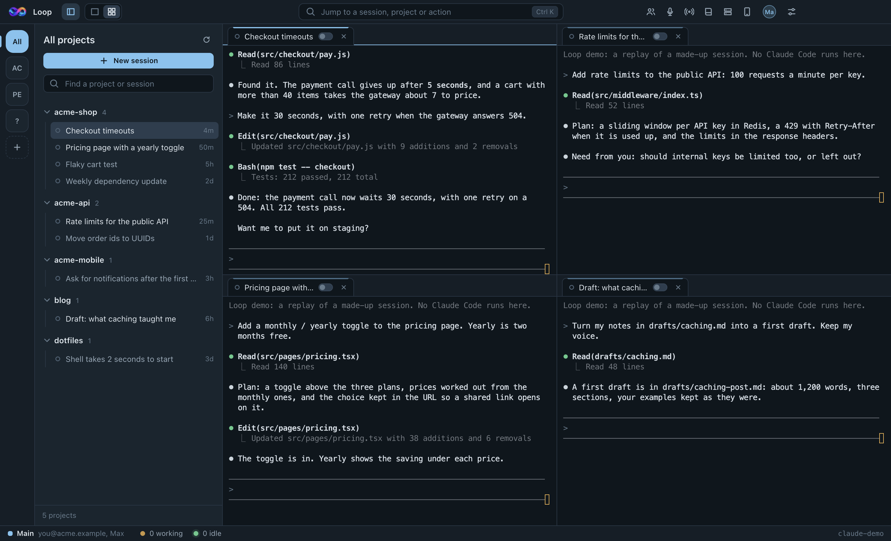

# Loop

**A control room for Claude Code.** Run many Claude Code sessions side by side on Windows, give them roles and a shared memory, and follow or steer them from your phone, including by voice with the screen off.

[](https://github.com/gursewak8427/loop/actions/workflows/test.yml)
[](LICENSE)

<p align="center">
  
</p>

<p align="center"><sub>The desktop app on made-up projects (<code>npm run demo</code>).</sub></p>

<p align="center">
  
  &nbsp;
  
  &nbsp;
  
</p>

<p align="center"><sub>The phone app, drawn from the code with made-up data (<code>npm run screenshots</code>).</sub></p>

## Why

Claude Code is one terminal and one conversation. Real work quickly turns into five of them: a backend session, a frontend one, one on a server, one reviewing. Loop is the window that holds them all.

- **Every session, organised.** Workspaces hold projects, projects hold sessions. Each one opens as a real terminal at its project folder, already resumed. Live lamps show which are working, idle or stopped.
- **Sessions that work as a team.** Give each a role (CEO, CTO, developer, QA...). They get a shared memory, a task board and a way to message each other, so you give one goal and the work is passed along.
- **Your phone as the remote.** Over your own Tailscale network: read any session as a conversation, answer the questions Claude asks, approve a plan, send a photo.
- **Voice mode.** Open a session on the phone, tap the waveform button and talk. Loop sends what you said, waits for the answer, reads it out in a sentence or two, and listens again. It is built for working with your eyes closed.
- **Servers too.** A session can run on another machine over SSH, inside `tmux`, so it keeps working when you close everything.
- **Several Claude accounts.** Pick one per workspace, project or session, and switch a running session to another when one runs out.

## Requirements

- Windows 10 or 11. macOS runs from source (see [CONTRIBUTING.md](CONTRIBUTING.md)); Linux should too, but is untested.
- [Claude Code](https://docs.anthropic.com/en/docs/claude-code) installed and signed in (`claude` on your `PATH`).
- For the phone: [Tailscale](https://tailscale.com) on the PC and the phone. For voice mode in a phone browser, turn on MagicDNS and HTTPS certificates for your tailnet, because a browser only gives a page the microphone over HTTPS.

## Install

Download the Windows installer from [Releases](https://github.com/gursewak8427/loop/releases). It is not code-signed yet, so Windows SmartScreen will warn you the first time: choose **More info → Run anyway**.

Or build it yourself (Node 24 and the [Flutter](https://flutter.dev) SDK, stable channel):

```
npm ci
npm run web      # builds the phone app that Loop serves to your phone
npm start        # runs Loop from source
```

To look around without your own sessions, `npm run demo` starts Loop on made-up projects instead. Your own `~/.claude` and Loop settings are not touched.

`npm run pack` builds the app into `release\win-unpacked\Loop.exe`, and `npm run dist` builds an installer.

## Use it from your phone

1. In Loop, open **Your phone** and turn it on. It shows an address, a port and a pairing code.
2. On the phone, open the address in Chrome, or install the app (see [app/README.md](app/README.md) for Android and iPhone).
3. Enter the pairing code once.

Use the Tailscale address (it starts with `100.`) and it works from anywhere. For voice mode in the browser, use the `https://<your-pc>.<tailnet>.ts.net:8788` address that Loop shows.

Loop gives whoever pairs full control of your sessions. Keep it on your private Tailscale network and never forward its ports to the internet.

## Contributing

Contributions are welcome, from a typo to a feature. Start with [CONTRIBUTING.md](CONTRIBUTING.md), and see the issues labelled [good first issue](https://github.com/gursewak8427/loop/issues?q=is%3Aissue+is%3Aopen+label%3A%22good+first+issue%22).

## License

[MIT](LICENSE) © Prismaple

---

# Reference

The rest of this page describes each part of Loop in detail.

- Tests: `npm test` (desktop), and `cd app && flutter test` (phone).
- After changing desktop code: close the app, then `npm run pack`.

## What it does

|                |                                                                                                                                                                                                                                                                                                                                                     |
| -------------- | --------------------------------------------------------------------------------------------------------------------------------------------------------------------------------------------------------------------------------------------------------------------------------------------------------------------------------------------------- |
| Workspaces     | One per top-level folder on first run. Add, rename, recolour, delete; move any project between them.                                                                                                                                                                                                                                                |
| Sessions       | Read from `~/.claude/projects`. Live lamps: amber working, green idle, hollow not running.                                                                                                                                                                                                                                                          |
| Open           | One click runs `cmd` at the project root with `claude <options> --resume <id>`.                                                                                                                                                                                                                                                                     |
| Focus and Grid | One group of tabs with one terminal showing, or every open terminal side by side.                                                                                                                                                                                                                                                                   |
| Splits         | Drag a tab onto the left, right, top or bottom of any terminal and it snaps into that half; drop it in the middle or on a tab strip to join that group. Drag the line between two panes to resize, double-click it to even them out.                                                                                                                |
| Windows        | Drag a tab out of the window, or right-click it and choose Move to a new window. The terminal keeps running and keeps its screen. Extra windows split the same way, tabs can be dragged between windows, and closing an extra window sends its terminals back to the main one.                                                                      |
| Jump (Ctrl+K)  | Type part of a session, project or action name.                                                                                                                                                                                                                                                                                                     |
| Teams          | Save the open sessions as a named set and reopen them together.                                                                                                                                                                                                                                                                                     |
| Broadcast      | Send one prompt to several sessions, introduce them to each other, or stop them all. Keeps prompts you send often.                                                                                                                                                                                                                                  |
| Roles          | Give a session a one-line role. Teammates see it; the session is told it on start.                                                                                                                                                                                                                                                                  |
| Peek           | Read the last messages of a session without starting it.                                                                                                                                                                                                                                                                                            |
| Move here      | A session running in another terminal can be stopped there and resumed here.                                                                                                                                                                                                                                                                        |
| Memory         | Shared notes per project and a private knowledge base per session.                                                                                                                                                                                                                                                                                  |
| Tasks          | A board per project. Sessions add tasks, take them and report progress; you see and edit it in the Memory panel.                                                                                                                                                                                                                                    |
| Keep running   | Closing the window can leave sessions working in the notification area.                                                                                                                                                                                                                                                                             |
| Accounts       | Several Claude logins side by side. Pick one per workspace, project or session, and switch a running session to another account.                                                                                                                                                                                                                    |
| PC load        | Processor, memory and graphics card use in the bottom bar.                                                                                                                                                                                                                                                                                          |
| Remote Control | A switch on every session tab, working on the running session with no restart. On connects it to claude.ai and the phone app. Off disconnects it and deletes its copy from claude.ai, archive included. A session opened with the switch off is cleaned the same way first, so one that had Remote Control on elsewhere cannot reconnect by itself. |

## Shortcuts

| Keys                                 | Action                                         |
| ------------------------------------ | ---------------------------------------------- |
| Ctrl+K                               | Jump to a session, project or action           |
| Ctrl+Tab, Ctrl+Shift+Tab             | Next, previous terminal                        |
| Alt+1 to Alt+9                       | Go to that terminal                            |
| Ctrl+Shift+G                         | Focus or Grid                                  |
| Ctrl+Shift+B                         | Broadcast bar                                  |
| Ctrl+Shift+M                         | Memory panel                                   |
| Ctrl+Shift+E                         | Show or hide the project list                  |
| Ctrl+Shift+W                         | Close the terminal                             |
| Ctrl+Plus, Ctrl+Minus, Ctrl+0        | Terminal text size                             |
| Shift+Enter                          | New line in a Claude prompt                    |
| Ctrl+C with a selection, right-click | Copy; right-click with nothing selected pastes |

## How sessions work together

Claude Code already lets local sessions message each other with its `SendMessage` tool. Loop adds what is missing around it:

- **Introduce them** (Broadcast bar) tells each selected session who its teammates are, their roles and where they work.
- **`team_list`** is a tool every session opened here gets. It lists the sessions running right now with names, roles and whether they are busy.
- **Memory** gives them a shared place to leave decisions and facts for each other.

## Accounts

The main account is the Claude Code login already on this PC. Add more from the person icon in the title bar: name the account, and a tab opens that runs `claude auth login`, which signs in through your browser. The tab closes when the login is in place.

- **Which account a session uses**: its own choice if it has one, otherwise its project's, otherwise its workspace's, otherwise the default account. Set these by right-clicking a session or project, or in the workspace's settings.
- **Out of usage on one account**: right-click the tab, choose Switch account. The session restarts under the other login at the same point in the conversation.
- **Two accounts at once**: nothing to set up; every terminal carries its own account.

Each extra account is a Claude Code config folder under `%APPDATA%\Loop\accounts`. It holds that account's login and nothing else of its own: session history, the live session list, plugins and skills are links to `~/.claude`, and settings, `CLAUDE.md` and MCP servers are copied from it at every launch. So change settings in your main setup; a change made while running under an extra account is overwritten. Connector sign-ins (the MCP servers and plugins you authorised, such as GitHub or Vercel) are kept the same under every account: whichever copy is freshest is given to all of them, at start and whenever one changes. Connectors that live on claude.ai itself belong to each Claude account and have to be connected there once per account. Removing an account signs it out and deletes its folder; sessions are untouched. Claude Desktop keeps its own login and is not affected.

## Deleting a session

Right-click a session on this PC and choose Delete session. Its conversation leaves the list and its team, and is kept for 30 days: the "deleted" link at the bottom of the project list brings it back. After 30 days it is removed for good. Hide session only takes it out of the list.

## Teams and the board

A project on this PC can have a team and a board, the way a small company runs one.

- **Team**: right-click a project and choose Create a team. Sessions are on the left and roles on the right (CEO, CTO, project manager, developer, DevOps engineer, QA, designer, SEO, marketing, or your own): drag each session onto its role, or use Match by name to place the ones whose names say their role. A role nobody holds can get a new session of its own when you save: it starts named after the role and reads its brief. Several sessions can share a role. A session is told its role when it starts in Loop; one that is open and idle is told at once. The session's right-click menu changes its role later.
- **What a role knows**: the pencil on a role opens its playbook: what it is responsible for, how it works, and which roles it hands work to. This is global, so editing the CTO once changes it in every project. A session reads it with `role_brief` when it starts and whenever it is given a goal, together with the names of the teammates who are next in this project, so you give a goal to one session and it passes the work on by itself. Roles Loop ships with can be reset to their default wording.
- **In the list**: a project with a team shows its sessions under their roles, each role a branch you can fold. Sessions without a role sit under External members.
- **How sessions learn the team**: nothing about the team is copied into a conversation or a note. The `team_info` tool reads it from Loop's settings at the moment it is called: a short list of roles and who holds each, or one role in full when asked. A member is told at every start to call it before answering anything about the team, because what its conversation remembers may be out of date, and open members are told when you change the team.
- **Sessions can run the team too**: the `team_manage` tool lets a session give or take a role, add or drop a role, start a new session (with a role if wanted), rename a session, or close an idle one. The CEO and the project manager may do all of it; any session may rename itself; while a project has no team, any session may start one.
- **Give the team a goal**: the board has a goal box. What you type goes to one session (the CEO, else the CTO, else the project manager), and the roles pass the work on from there: a teammate that is closed is opened by the one who needs it, tickets appear on the board, and the first session reports back when it is done.
- **Board**: the columns icon on a project opens its tickets in five columns: To do, In progress, Review, Blocked, Done. Drag a ticket to move it, click it to edit, assign or comment. It redraws by itself when a session changes something.
- **Who may do what**: with a project manager on the team, only that session adds, assigns and edits tickets. Every other session can comment on any ticket and move the tickets assigned to it; anything else it has to ask the manager for. Without a project manager the board is open to every session. You can always do everything.

The board is one small file per project in the memory folder, read only when it is opened or changed. Teams and boards are not available for projects on a server.

## Servers

A session can run on another machine, so that machine does the work. Add one from the server icon in the top bar: its address, the user to log in as, and optionally a key file. Loop uses the SSH program already on this PC and installs nothing on the server; it needs to log in with a key, without a password prompt.

- **Starting one**: every workspace has a New session button. It asks where the session runs, this PC or a server, and in which folder. On a server you browse its folders, make a new one, or paste a git address to have the server clone the project there.
- **Server projects live in your workspaces**: a session started from a workspace is filed there, wherever it runs, with a dashed label naming the server. The server's own entry in the rail lists everything on it; projects not yet in a workspace are under "?" and can be moved with Move to workspace.
- **Sessions keep running**: each one runs inside `tmux` on the server, so closing the tab, Loop or this PC leaves it working. Opening it again reattaches. "Stop it on the server", in the tab menu or the session's right-click menu, ends it. Without tmux on the server, a session stops when its tab closes.
- **Dropped connections**: if the connection to the server drops, the tab waits for the server and attaches again by itself. Server sessions that were open when Loop closed are attached again at the next start if they are still running.
- **Load**: the server's processor and memory use is in the bottom bar while one of its sessions is in front.
- **Plain terminal**: "Open a terminal" gives an ordinary SSH shell, in a project folder or in the home folder.
- **Sign in to Claude there**: runs Claude Code's own sign-in on the server in a tab. The server has its own login, separate from this PC.
- **Code gets there through git**: a server project is a clone on the server, made by the server with its own access. Loop never uploads files.
- **Who sessions run as**: SSH can log in as one user and run sessions as another, for example log in as root and work as a normal user. Choose it from "as <user>" in the Servers panel or "Change user" in the New session dialog; Loop lists the users on the server and can add a plain one (a home folder, no password, no admin rights). Each user has their own Claude sign-in, folders and sessions, so this is also how one server holds more than one Claude account. The first time you start a session on a root login, Loop asks which user to use.
- **Root**: Claude Code does not skip permission prompts for root, so sessions run as root ask before each action. Run them as a normal user for unattended work.
- **Remote Control**: the switch on the tab works for server sessions too. Off deletes the copy on claude.ai, using the server's own Claude login for that one call.

Not available for server sessions: the shared memory and tasks, which stay on this PC by design. Messaging between a session on the server and one on this PC is not possible; sessions run by the same user on the same server can message each other.

## Memory

Memory is local. It lives in one folder that you choose in Settings > Memory folder (default `%APPDATA%\Loop\memory`). The folder holds only markdown files, so it is portable: copy or move it anywhere, then choose it again in Settings. Picking a folder that already holds Loop memory adopts it as it is.

```
<memory folder>/
  <project>/project/*.md               shared by every session in the project
  <project>/members/<session id>/*.md  one session's own knowledge base
  <project>/board.json                 the project's task board
```

Sessions opened here get a `team-memory` MCP server with `memory_search`, `memory_save`, `memory_list`, `memory_read`, `memory_delete`, `team_list`, `task_list`, `task_add` and `task_update`. On start each session is also given the titles of the notes already saved, so it knows what is worth searching for. Search is BM25 over passages of about 220 tokens, and a reply is cut to a token budget (1200 by default), so a session pulls the few passages it needs instead of loading everything.

Notes that Claude Code saved on its own for a project (`~/.claude/projects/<project>/memory`) appear under "Claude's notes". They are searchable and read-only; copy one into project memory to edit or share it.

## Data

- `%APPDATA%\Loop\config.json`: workspaces, teams, roles, hidden and pinned items, settings.
- `%APPDATA%\Loop\accounts`: one folder per extra Claude account.
- Nothing under `~/.claude` is modified by the app itself, with one exception: when a session is opened with its Remote Control switch off but its history still points at a remote copy, the app appends the same one-line "disconnected" record Claude Code writes itself. Sessions running under an extra account write their history there, as they would under the main one.

## Code

- `src/main/scanner.js` reads transcripts and the live session registry
- `src/main/ptys.js` and `pty-host.js` terminals (ConPTY through `@lydell/node-pty`), run in a helper process so they cannot stall the window
- `src/main/accounts.js` extra Claude logins
- `src/main/stats.js` PC load for the bottom bar
- `src/main/servers.js` sessions on other machines over SSH
- `src/main/memory.js` note store, search, MCP server
- `src/main/main.js` window, settings, IPC
- `src/renderer/` the interface (plain JavaScript and xterm.js, no build step); `layout.js` holds splits, drag and drop and extra windows
